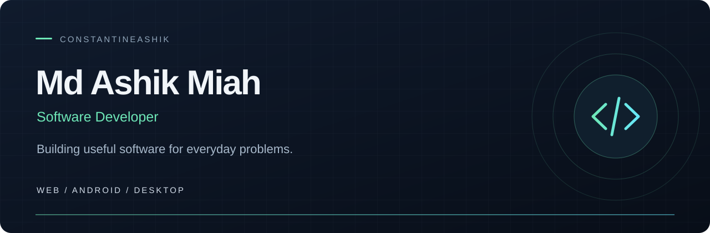

  

  <a href="#selected-work">Selected work</a> &nbsp; / &nbsp;
  <a href="#toolkit">Toolkit</a> &nbsp; / &nbsp;
  <a href="https://github.com/ConstantineAshik?tab=repositories">All repositories</a>

 

### Hi, I'm Ashik.

I build web applications, Android apps, and desktop tools. My projects explore practical problems: organizing files, diagnosing development environments, managing bookings, and making everyday software more useful.

I'm interested in thoughtful interfaces, local-first tools, and applied AI.

 

## Selected work

<table>
<tr>
<td width="50%" valign="top">

### [DevDoctor](https://github.com/ConstantineAshik/DevDoctor)
**Understand your development environment.**

A Windows diagnostic tool that explains problems with Git, Node, Python, Docker, ports, services, and projects in plain English. Runs locally.

`Rust` · `Developer tools` · `Windows`

</td>
<td width="50%" valign="top">

### [SmartMessage](https://github.com/ConstantineAshik/SmartMessage-Android)
**A smarter inbox, on your device.**

An open-source Android SMS and MMS app with on-device AI classification, smart categories, OTP detection, and a Material 3 interface.

`Kotlin` · `Android` · `On-device AI`

</td>
</tr>
<tr>
<td width="50%" valign="top">

### [Hotel Booking & Management](https://github.com/ConstantineAshik/Hotel-Booking-and-Management)
**From room discovery to administration.**

A customizable booking platform with an admin-controlled CMS, room pricing, availability, bookings, payments, and a homepage builder.

`TypeScript` · `Web applications` · `CMS`

</td>
<td width="50%" valign="top">

### [FileSort Desktop](https://github.com/ConstantineAshik/FileSort-Desktop)
**Bring order to your files.**

A Windows file organizer with a preview of planned changes, category-based folders, and full undo.

`C#` · `Desktop` · `Productivity`

</td>
</tr>
</table>

**Also exploring:** [a local-first music player](https://github.com/ConstantineAshik/The-Pensieve-Player) · [computer vision for traffic risk](https://github.com/ConstantineAshik/Automated-Traffic-Risk-Assessment) · [NLP for YouTube comments](https://github.com/ConstantineAshik/NLP-Based-YouTube-Comment-Analysis)

 

## Toolkit

| Area | Technologies used across my projects |
| :--- | :--- |
| Web | TypeScript, JavaScript, Next.js, Tailwind CSS |
| Android | Kotlin, Material 3 |
| Desktop & tooling | Rust, C#, Python |
| AI & data | Python, Jupyter, computer vision, NLP |

 

---

  <strong>Explore the code. Follow the progress.</strong> 
  <a href="https://github.com/ConstantineAshik?tab=repositories">Browse my repositories →</a>

